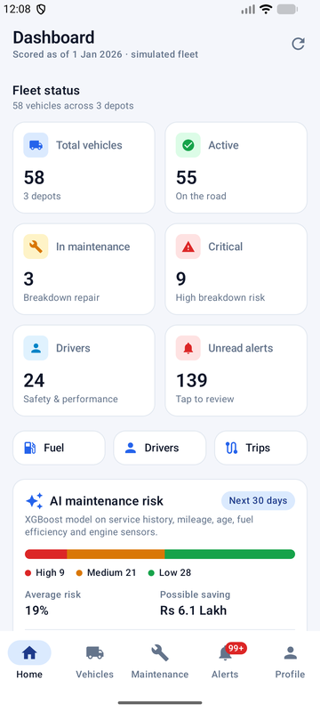
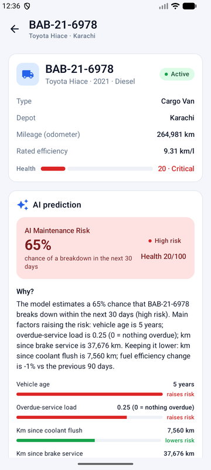
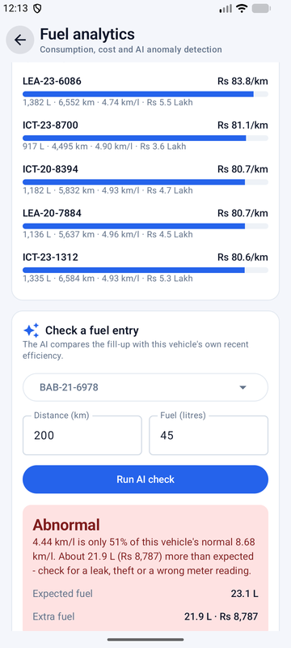
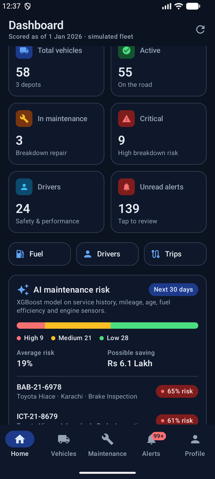
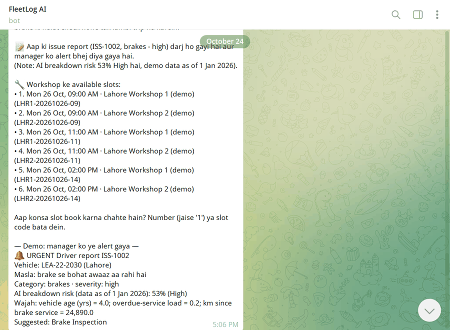
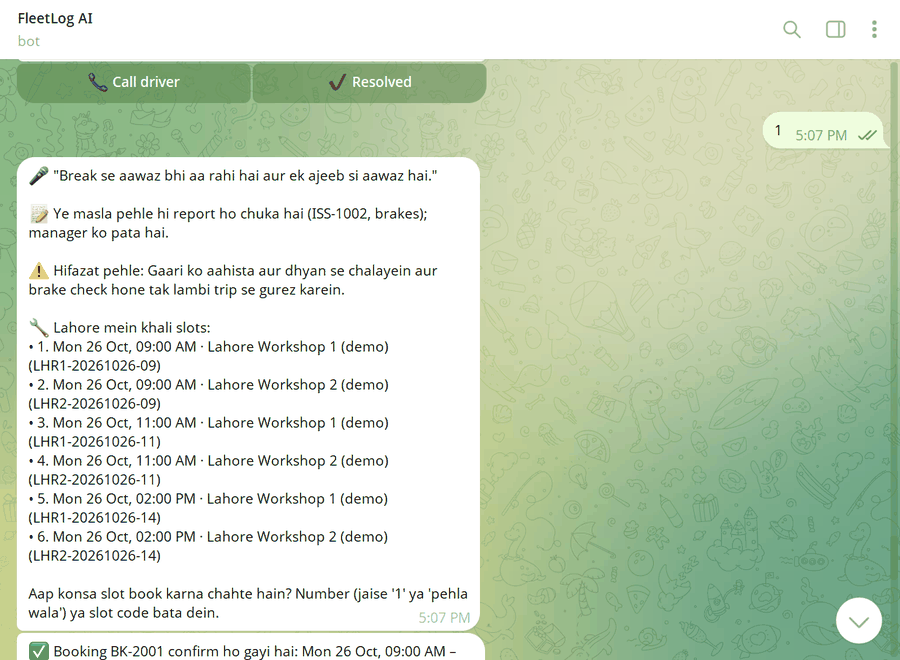
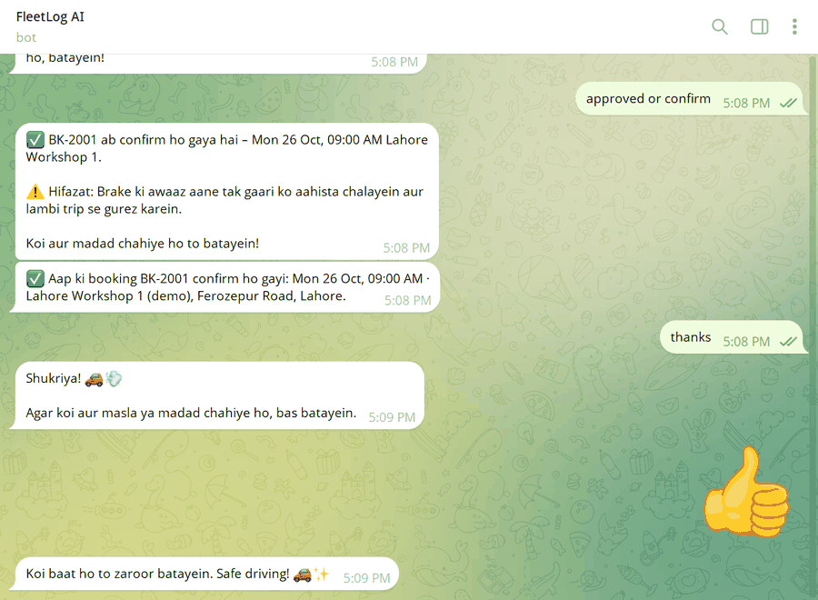
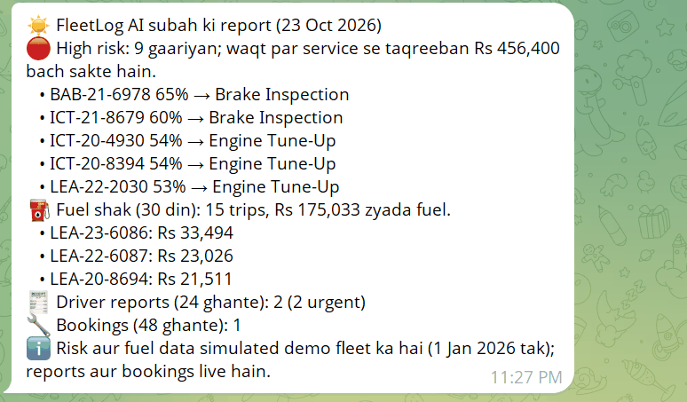
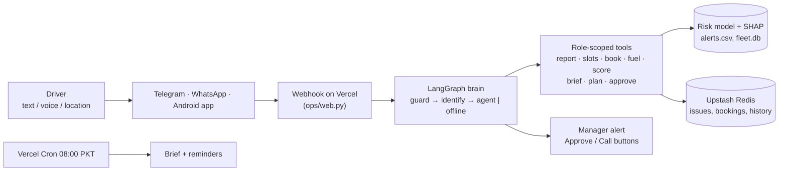
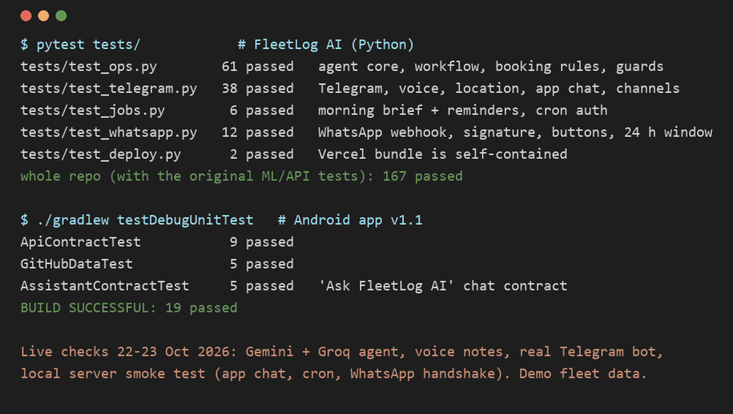

# AI Fleet Management & Maintenance System

**Live demo:** https://ai-fleet-management.streamlit.app/ (Streamlit Community Cloud; may take a minute to wake up)

**Android app:** [download the APK](https://github.com/ZeeRiz99/AI-Fleet-Management-Maintenance/releases/latest) · [app README](android/README.md)

**FleetLog AI (Telegram bot + AI agent):** [t.me/zeeriz_bot](https://t.me/zeeriz_bot) · [what it does](#fleetlog-ai--ai-fleet-log-assistant)

<p>
  
  
  
  
</p>

Predicts which vehicles are likely to break down in the next 30 days, explains why (SHAP), flags abnormal fuel use,
and puts a rupee value on acting early. Built for a Pakistan fleet: km, litres, PKR.

```
vehicles / drivers / trips / fuel / maintenance -> SQLite -> features -> ML
   -> breakdown risk (XGBoost + SHAP) + fuel anomalies -> alerts with Rs impact -> Streamlit dashboard + assistant chat
```

## Quick start (Windows / PowerShell)

```powershell
python -m venv .venv
.venv\Scripts\Activate.ps1
pip install -r requirements.txt
python src/run_pipeline.py            # ~4 min: data -> SQLite -> features -> models -> alerts
streamlit run app/streamlit_app.py    # dashboard at http://localhost:8501
python -m pytest -q                   # sanity tests
```

`python src/run_pipeline.py --skip-generate` reuses the existing CSVs. The raw datasets in `data/raw/` are included.

## What is in the dashboard

| Tab | What it shows |
|---|---|
| Overview | fleet KPIs, fuel cost per km trend, maintenance spend, risk by depot |
| Risk & Alerts | vehicles ranked by 30-day breakdown risk, reasons, recommended service, Rs saving, CSV export |
| Vehicle | one vehicle: risk, why, fuel-efficiency trend, engine readings, maintenance history |
| Fuel | cost per km by vehicle/model/depot/route, price trend, flagged anomalies with excess Rs |
| Maintenance | spend by type, breakdowns per month, costliest vehicles |
| Drivers | experience vs harsh braking |
| Model | metrics, SHAP drivers, honest limitations |
| Assistant | ask in Roman Urdu / English; calls the same data as tools |

### Assistant modes
| Mode | When | Needs |
|---|---|---|
| **Gemini** (free tier) | a Gemini key is set | free key from https://aistudio.google.com/apikey |
| **Claude** | an Anthropic key is set and no Gemini key | `ANTHROPIC_API_KEY` (paid) |
| **Offline** | no key, or any LLM call fails (quota, network, bad key) | nothing |

Give the key either in the dashboard sidebar ("Assistant AI key", kept only in that browser session) or as an environment
variable (`GEMINI_API_KEY`, `ANTHROPIC_API_KEY`; optional `GEMINI_MODEL`, `FLEET_AGENT_MODEL`,
`FLEET_LLM_PROVIDER=offline|gemini|anthropic`). All three modes use the same tools on the same data, so the LLM can only
quote numbers the tools return. The offline router is kept as a fallback so the demo never breaks when a free quota runs out.

**Honest status:** the Gemini and Claude tool loops are tested with fake clients (`tests/test_agent_llm.py`) and the SDK
request types are built with the real libraries, but they have **not been run against the live APIs** (no keys were
available during the build). Default Gemini model is `gemini-3.8-flash`; if Google has retired it, set `GEMINI_MODEL`.

## REST API (for the Android app)

A FastAPI service in `api/` exposes the same data and models to the **FleetAI Android app** (`android/`, see its
[README](android/README.md); download the APK from
[Releases](https://github.com/ZeeRiz99/AI-Fleet-Management-Maintenance/releases/latest)). Streamlit is not involved.

```powershell
.venv\Scripts\python.exe -m uvicorn api.main:app --host 0.0.0.0 --port 8000   # docs: http://localhost:8000/docs
```

- The API works on its own copy of the database (`data/runtime/fleet_api.db`, git-ignored), so recording a service
  through the app never changes `data/fleet.db`. `POST /api/v1/admin/reset-demo` restores the copy.
- Auth: `POST /api/v1/auth/login` returns a JWT (HS256, 12 h); every other route except `/health` needs
  `Authorization: Bearer <token>`. Demo login `admin` / `fleet123`.
- Settings (environment variables): `FLEET_ADMIN_USER`, `FLEET_ADMIN_PASSWORD` (set it for anything beyond a local
  demo), `FLEET_API_SECRET` (otherwise generated once and stored in `data/runtime/app_state.db`),
  `FLEET_TOKEN_MINUTES`, `FLEET_RUNTIME_DIR`.

| Area | Endpoints (prefix `/api/v1`) |
|---|---|
| System / auth | `GET /health`, `POST /auth/login`, `GET /auth/me` |
| Dashboard | `GET /dashboard` |
| Vehicles | `GET /vehicles`, `GET /vehicles/{id}` (includes AI prediction + SHAP + schedule), `GET /vehicles/{id}/trips` |
| Maintenance | `GET /maintenance/summary`, `GET /maintenance/schedule`, `GET /maintenance/history`, `POST /maintenance` (record a service, then re-score) |
| Fuel | `GET /fuel/summary`, `GET /fuel/anomalies` |
| Drivers / trips | `GET /drivers`, `GET /drivers/{id}`, `GET /trips` |
| Alerts | `GET /alerts`, `POST /alerts/{id}/read`, `POST /alerts/read-all` |
| AI | `GET /ai/model`, `POST /ai/predict/{id}`, `POST /ai/fuel-check` |
| Admin | `POST /admin/reset-demo` |

Risk scores come from the same `src/alerts.py` scoring (XGBoost + SHAP) as the dashboard; `tests/test_api.py`
(15 tests) covers auth, every endpoint and the record-service → re-score loop.

**Published snapshot for phones without a server.** Free API hosting now needs a card or a paid plan, so
`python -m api.export_static` saves every read endpoint's real response as JSON in `static-api/v1/` (about 105 files,
2 MB: dashboard, 58 vehicles with AI predictions and SHAP reasons, 24 drivers, maintenance, fuel, alerts, model
info, per-vehicle fuel baselines). The Android app reads these from GitHub by default, so it works on any phone;
writes that need the model (record a service → re-score) still need the live server. A test fails if the snapshot
gets out of date: re-run the export after retraining or regenerating data, then commit `static-api/`.

## FleetLog AI — AI Fleet Log Assistant

Drivers don't fill forms; they send WhatsApp/Telegram voice notes. FleetLog AI turns those messages into fleet
records and actions: a driver reports a problem in Roman Urdu (text or voice), gets safety advice first, the issue is
scored with this project's breakdown model, the manager is alerted with buttons, and the driver books a workshop slot
that the manager approves with one tap. Every morning the manager gets a brief.

**Try it:** open [t.me/zeeriz_bot](https://t.me/zeeriz_bot) → `driver LEA-22-2030` → `brake se bohat awaaz aa rahi hai`
→ `kal subah slot` → `pehla wala` → `manager` → ✅ Approve → `brief`. (Demo mode: you also see the manager's copy.)

<table>
  <tr>
    <td></td>
    <td></td>
  </tr>
  <tr>
    <td>Driver report → safety advice, issue ISS-1002, AI risk 53 %, manager alert with buttons</td>
    <td>Voice note transcribed; the same problem is not reported twice; free workshop slots</td>
  </tr>
  <tr>
    <td></td>
    <td></td>
  </tr>
  <tr>
    <td>Manager approves BK-2001 → the driver gets the confirmation</td>
    <td>Morning brief: high-risk vehicles, Rs saving, fuel suspects, reports, bookings</td>
  </tr>
</table>



What is behind it (all in [`ops/`](ops/README.md)):

* **Agent:** LangGraph workflow; LLM chain Gemini → Groq through the OpenAI-compatible API, with a keyword router as the
  offline fallback, so the bot keeps working when free quotas run out.
* **Guards learned from live tests:** replies that claim an action the model did not take, or numbers no tool returned,
  are rejected; safety advice always comes first; one report per problem; a slot is locked atomically (no double booking);
  drivers only ever see their own vehicle.
* **Channels:** Telegram (webhook, secret-checked), WhatsApp Cloud API (signature-checked), and an "Ask FleetLog AI" chat
  screen in the Android app; voice notes via Gemini audio / Groq Whisper.
* **Hosting (free tiers):** Vercel Hobby (serverless Python) + Upstash Redis; daily cron for the brief.

**Status, honestly:** Telegram, the AI agent, voice notes, the brief and the Vercel deployment are live-tested
(Oct 2026). The WhatsApp channel and the app's chat screen are built and unit-tested but not yet tested live. Risk and fuel
figures come from the simulated fleet scored as of 1 Jan 2026; reports and bookings are live. Vercel Hobby is for
non-commercial use; a client deployment needs paid plans (see [ops/README.md](ops/README.md)).



## Project layout

| Path | Purpose |
|---|---|
| `src/config.py` | prices (petrol Rs 387.40/L, diesel Rs 400.35/L), unit conversions, simulation + cost assumptions |
| `src/generate_data.py` | hybrid generator (see below) |
| `src/db.py` | CSV -> `data/fleet.db` (SQLite) |
| `src/features.py` | weekly per-vehicle snapshots; label = breakdown in next 30 days |
| `src/train.py` | XGBoost, time-based split, threshold on validation, SHAP |
| `src/anomaly.py` | fuel anomaly detection: rolling-baseline rule vs IsolationForest |
| `src/alerts.py` | today's scores + reasons + cost impact -> `data/processed/alerts.csv` |
| `src/agent.py` | assistant tools + offline/Claude chat |
| `src/eda.py` | data-quality report -> `reports/data_quality.md` |
| `app/streamlit_app.py` | dashboard |
| `api/` | FastAPI backend for the Android app (`main.py` routes, `fleet.py` service, `schemas.py`, `security.py`, `export_static.py`) |
| `static-api/v1/` | read-only JSON snapshot of the API, read by the Android app's default "GitHub data" mode |
| `android/` | FleetLog AI Android app (Kotlin, Jetpack Compose, MVVM) |
| `ops/` | FleetLog AI agent: LangGraph brain, tools, Telegram/WhatsApp channels, web app for Vercel ([ops/README.md](ops/README.md)) |
| `docs/fleetlog-ai/` | FleetLog AI spec, screenshots, optional Google Sheets event log |
| `tests/` | data integrity, no-leakage, label, model, alert and assistant tests |

## Data: hybrid, and what that means

* **mindweave/vehicle-fleet-management** (Hugging Face, CC-BY-NC): the free sample has only 58 vehicles, 15 drivers and 50
  maintenance rows and no breakdown labels. It is used as the **template**: vehicles, depot sizes, trip-distance and mpg
  statistics, converted to km/litres/PKR and mapped to Pakistani cities and models (Hiace, Isuzu NPR, Sprinter).
* **mukherjee78/predictive-maintenance-engine-data** (Hugging Face, MIT): 19,535 real engine-sensor readings. Weekly
  sensor readings per vehicle are **sampled from it**, from the "needs attention" class more often when the vehicle's
  services are overdue. The README of that dataset does not define its labels; label 0 is assumed "needs attention"
  because it shows higher RPM and lower fuel pressure.
* **Simulated** 2023-2025: trips, fuel, maintenance and breakdowns. Breakdown hazard depends on overdue services, vehicle
  age and driver harshness; fuel anomalies (+35% to +120% litres) are injected as ground truth. The generator is kept so
  the project does not depend on the non-commercial licence of mindweave.

## Results (time-based test on 2025) and how to read them

**Breakdown risk** (train < 2024-12-01, 30-day gap, test 2025; 2,689 weekly snapshots, 20% positive):

| Model | ROC-AUC | PR-AUC | Precision | Recall | Precision in top 10% |
|---|---|---|---|---|---|
| XGBoost | 0.741 | 0.414 | 0.343 | 0.690 | 0.515 |
| Baseline: overdue-service rule | 0.705 | 0.411 | 0.396 | 0.479 | 0.519 |
| Random | 0.500 | 0.200 | - | - | - |

Probabilities are not re-weighted for class imbalance, so they are close to calibrated (mean predicted 16% vs 20% actual on
test). The threshold (0.133) is chosen on a validation window. Main drivers (SHAP): vehicle age, overdue-service load, km since
brake / transmission service, change in fuel efficiency.

**Fuel anomalies** (test 2025): rule "km/l below 0.81 x the vehicle's own recent median" gets precision 0.99 / recall 1.00
(F1 0.994); IsolationForest gets F1 0.941. This is high because the injected anomalies are strong - expect lower on real data.

**Alerts today:** 9 High, 21 Medium, 28 Low vehicles; servicing the High/Medium ones is estimated to save about Rs 0.6M net
under the assumptions below.

## Assumptions to review (all in `src/config.py`)

* Downtime costs Rs 25,000 per vehicle-day; an overdue service removes 60% of breakdown risk. These drive every "net saving" figure.
* Risk tiers: High >= 30%, Medium >= 15% probability of a breakdown within 30 days.
* Fuel prices: today's rates are the ones given; the earlier history is a smooth simulated drift, not real prices.
* "Today" is 2026-01-01 (the day after the data ends).

## Limitations

* The fleet is simulated, so the model rediscovers the structure that was put into the data. It shows the method works end to
  end; it does not prove accuracy on a real fleet. Re-train on real telematics/maintenance records before relying on it.
* The risk model beats a plain "overdue services" rule on recall and ROC-AUC but not clearly on top-10% precision.
* Fuel anomalies are easy to detect here because they were injected strongly; real leaks and theft are subtler.
* GPS/IoT is out of scope; it is a natural extension (live odometer, idling, routes).

## Data sources and licences

| Data | Source | Licence | Use here |
|---|---|---|---|
| `data/raw/{depots,drivers,vehicles,trips,maintenance}.csv` | Hugging Face `mindweave/vehicle-fleet-management` (free sample) | CC-BY-NC 4.0 (non-commercial) | template for the simulator; academic use |
| `data/raw/engine/engine_sensors.csv` | Hugging Face `mukherjee78/predictive-maintenance-engine-data` | MIT | real engine-sensor readings sampled into the simulation |
| `data/processed/*`, `data/fleet.db` | generated by `src/generate_data.py` | this project | simulated fleet (2023-2025) |

Attribution: mindweave (vehicle-fleet-management) and mukherjee78 (predictive-maintenance-engine-data) on Hugging Face.
Because of the non-commercial licence, do not use the bundled mindweave sample in a commercial product; the generator can
be rewritten to run without it.

## Python version and install notes
Python 3.11+ (developed on 3.14). `requirements.txt` has loose minimums; `requirements-lock.txt` has the exact versions
the results above were produced with. Generated files (`data/processed`, `data/fleet.db`, `models/`, `reports/`) are
included so the dashboard runs immediately; `python src/run_pipeline.py` rebuilds them.
